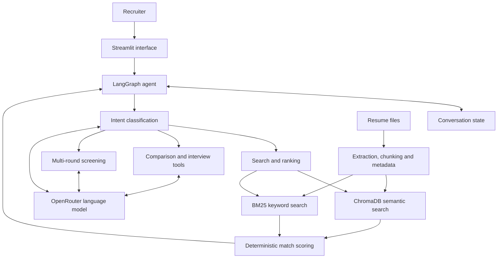

<div align="center">

# AI Resume Job Matcher

### From resume search to an explainable shortlist.

A conversational recruiter assistant combining hybrid retrieval,
transparent scoring, and stateful candidate evaluation.

**LangGraph · Streamlit · ChromaDB · SentenceTransformers · BM25 · OpenRouter**

[Overview](#overview) · [Capabilities](#capabilities) · [Architecture](#architecture) · [Quick start](#quick-start) · [Documentation](#documentation)

</div>

---

## Overview

Recruiters need to compare experience, refine requirements, and understand why a candidate appears on a shortlist. **AI Resume Job Matcher** brings these steps into a single conversational workflow.

The application extracts resume content, retrieves relevant candidates, calculates match scores, and supports follow-up analysis using the current search context.

> **The workflow:** Describe a role → retrieve candidates → inspect evidence → refine requirements → evaluate finalists.

## Capabilities

| Capability | What it enables |
| :--- | :--- |
| **Resume ingestion** | Process PDF, DOCX, and TXT resumes into searchable text, chunks, and candidate metadata. |
| **Hybrid retrieval** | Combine semantic similarity with BM25 keyword matching. |
| **Transparent ranking** | Score semantic relevance, keyword and skill coverage, and experience alignment. |
| **Conversational context** | Reuse the active shortlist and requirements across turns. |
| **Candidate comparison** | Review skills, experience, strengths, and trade-offs side by side. |
| **Ranking explanations** | Inspect score differences and supporting resume evidence. |
| **Interview preparation** | Generate role-specific questions and questions about gaps in resume evidence. |
| **Requirement refinement** | Update criteria through feedback such as “Make Docker mandatory.” |
| **Multi-round screening** | Progress from a shortlist to finalists and evidence-based recommendations. |

## Architecture



### Component responsibilities

| Layer | Implementation | Responsibility |
| :--- | :--- | :--- |
| Interface | `app.py` | Chat, candidate results, screening views, and state inspection. |
| Orchestration | `src/matching_agent.py` | Route requests through the LangGraph workflow. |
| State | `src/agent_state.py` | Represent requirements, candidates, messages, and screening results. |
| Ingestion | `src/resume_rag.py` | Coordinate parsing, metadata extraction, chunking, and indexing. |
| Matching | `src/job_matcher.py` | Retrieve and score candidates against role requirements. |
| Recruiter tools | `src/agent_tools.py` | Compare candidates, explain rankings, and prepare interview questions. |
| Screening | `src/screening_nodes.py` | Run initial screening, deeper analysis, and final evaluation. |
| Model configuration | `src/llm_config.py` | Configure the OpenRouter connection. |

### How matching works

The default scoring weights in `src/job_matcher.py` are:

| Signal | Weight | Purpose |
| :--- | ---: | :--- |
| Semantic similarity | **50%** | Measure how closely resume content relates to the role. |
| BM25 and skill coverage | **30%** | Combine keyword relevance and extracted skill alignment. |
| Experience alignment | **20%** | Compare extracted experience with the requested level. |

Within the 30% component, BM25 similarity and skill coverage receive equal weight. Match scores support comparison against the supplied requirements; they are not probabilities of hiring success.

### Screening stages

1. **Initial screening** — Retrieve and rank a shortlist of up to 10 candidates.
2. **Deep analysis** — Examine resume evidence and select up to 3 finalists.
3. **Final evaluation** — Assess mandatory requirements and produce recommendations with rationale.

Actual shortlist sizes depend on the indexed resumes and available matches.

## Quick start

Run these commands from the project root. The examples use Windows PowerShell and assume Python 3.10 or later is installed.

### 1. Prepare the environment

```powershell
python -m venv .venv
.\.venv\Scripts\Activate.ps1
python -m pip install -r requirements.txt
```

### 2. Configure the model

For a fresh setup, copy the environment template:

```powershell
Copy-Item .env.example .env
```

Set these values in `.env`:

```dotenv
OPENROUTER_API_KEY=your_openrouter_api_key_here
LLM_MODEL=openrouter/free
LLM_BASE_URL=https://openrouter.ai/api/v1
EMBEDDING_PROVIDER=sentence-transformers
EMBEDDING_MODEL=sentence-transformers/all-MiniLM-L6-v2
```

### 3. Index resumes

Place resume files under `data/selected_resumes/`, then run:

```powershell
python -m src.resume_rag
```

The pipeline writes processed data to `outputs/processed_resumes.json` and indexes resumes in the local `chroma_db/` directory. Its default ingestion mode resets the existing resume collection before indexing.

### 4. Launch the application

```powershell
python -m streamlit run app.py
```

Open the local address printed by Streamlit, usually `http://localhost:8501`.

## Try the conversation

Use these prompts in sequence to explore the recruiter workflow:

| Step | Example prompt |
| :--- | :--- |
| **Search** | “Find Python developers with 3+ years of experience in FastAPI and PostgreSQL.” |
| **Compare** | “Compare the top 3 candidates side by side.” |
| **Explain** | “Why did the top candidate rank higher than the second candidate?” |
| **Refine** | “Make Docker mandatory.” |
| **Prepare** | “Generate interview questions for the top candidate.” |
| **Screen** | “Run a full multi-round screening process on the top Python developer candidates.” |

## Project structure

```text
resume-rag-job-matcher-agent-mcp/
|-- app.py                    Streamlit application
|-- src/                      Agent, retrieval, scoring, and document processing
|-- data/                     Resume data and job descriptions
|-- docs/                     Architecture, demo, and requirement checklist
|-- tests/                    Conversation scenarios
|-- scratch/                  Phase-based verification scripts
|-- requirements.txt          Python dependencies
|-- .env.example              Configuration template
|-- README.md                 Existing project README
`-- PROJECT_OVERVIEW.md       This project guide
```

## Verification

The repository includes a runner for its phase-based checks:

```powershell
python scratch/test_all_phases.py
```

Review its output in your configured environment. This document does not assert a current test pass count.

## Implementation notes

- **Conversation memory:** LangGraph uses an in-memory `MemorySaver` checkpointer with a stable `thread_id`. State is retained within the running process, rather than in durable storage across restarts.
- **Evidence quality:** Extraction quality and resume completeness affect skill coverage, ranking, and generated analysis.
- **Model access:** Language model features depend on configured OpenRouter credentials and model availability.
- **Recruiter review:** Recommendations support human evaluation and should be reviewed alongside the underlying resume evidence.

## Documentation

| Resource | Contents |
| :--- | :--- |
| [System architecture](docs/architecture.md) | Detailed component design and state specification. |
| [State machine](docs/state_machine.mmd) | Mermaid definition of the agent workflow. |
| [Demo walkthrough](docs/demo_script.md) | Suggested sequence for a live demonstration. |
| [Requirement checklist](docs/assignment_checklist.md) | Mapping of requirements to implementation. |
| [Conversation scenarios](tests/conversation_flows.md) | Example flows for exercising agent behavior. |

---

<div align="center">

**Search with context. Compare with evidence. Review with clarity.**

</div>
