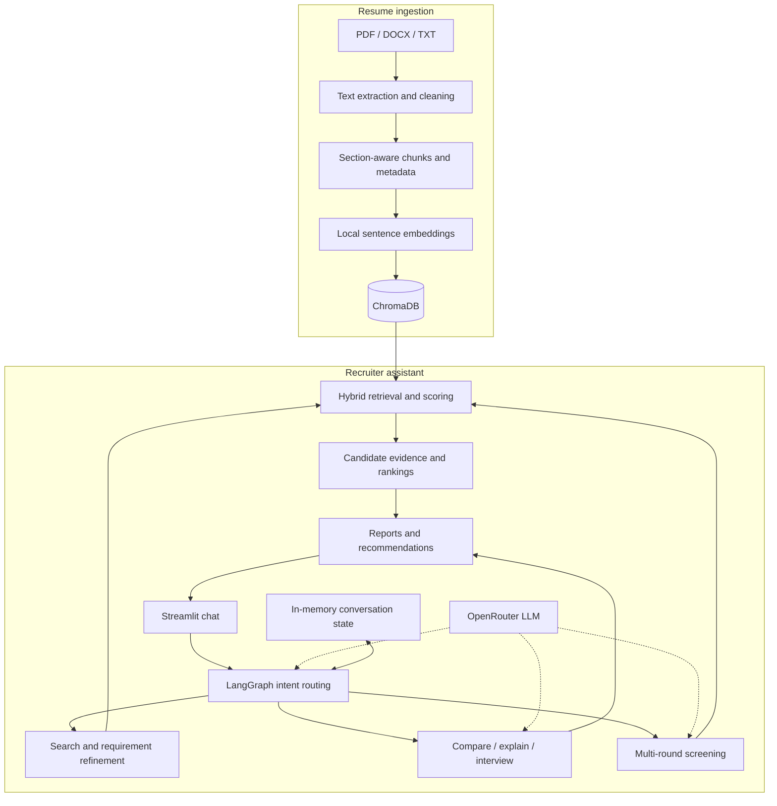

<div align="center">

# AI Resume Job Matcher

### From resumes to evidence-backed shortlists.

A stateful recruiter assistant for searching, comparing, and screening candidates through natural conversation.


[Overview](#overview) · [Quick start](#quick-start) · [Architecture](#architecture) · [Usage](#usage) · [Documentation](#documentation)

</div>

---

## Overview

AI Resume Job Matcher combines retrieval-augmented generation (RAG), hybrid search, and a LangGraph workflow to help recruiters evaluate resumes against job requirements. It pairs reproducible scoring with resume excerpts, conversational follow-ups, and structured screening reports.

Start with a job description, refine the requirements, compare the shortlist, and generate interview questions within the same conversation.

| Capability | What it delivers |
| --- | --- |
| **Resume ingestion** | PDF, DOCX, and TXT parsing, section-aware chunks, and candidate metadata extraction. |
| **Hybrid matching** | Semantic search, BM25 keyword matching, skill overlap, and experience scoring. |
| **Conversational refinement** | Update role requirements while retaining context within a session. |
| **Candidate comparison** | Compare skills, experience, strengths, and gaps across shortlisted candidates. |
| **Ranking explanations** | Review score differences alongside supporting resume evidence. |
| **Interview preparation** | Generate role-specific questions and probes for candidate gaps. |
| **Multi-round screening** | Shortlist up to 10 candidates, evaluate up to 3 finalists, and produce hire/no-hire recommendations. |

## Quick start

### 1. Prepare your environment

Use **Python 3.10+** and run the following commands from the project root. An OpenRouter API key enables the LLM-assisted features. The default embedding model downloads on first use and runs locally afterward.

```bash
python -m venv .venv
```

**Windows PowerShell**

```powershell
.\.venv\Scripts\Activate.ps1
```

**macOS / Linux**

```bash
source .venv/bin/activate
```

Install the project dependencies:

```bash
python -m pip install -r requirements.txt
```

### 2. Configure the application

Copy the included environment template.

**Windows PowerShell**

```powershell
Copy-Item .env.example .env
```

**macOS / Linux**

```bash
cp .env.example .env
```

Set your API key in `.env`. The default configuration is:

```dotenv
OPENROUTER_API_KEY=your_openrouter_api_key_here
LLM_MODEL=openrouter/free
LLM_BASE_URL=https://openrouter.ai/api/v1
EMBEDDING_PROVIDER=sentence-transformers
EMBEDDING_MODEL=sentence-transformers/all-MiniLM-L6-v2
```

### 3. Index the resumes

The sample dataset contains **50 PDF resumes across 10 categories** and **5 job descriptions**. To use your own resumes, place supported files under `data/selected_resumes/`; subfolders become category labels.

```bash
python -m src.resume_rag
```

This processes the resumes, writes extracted data to `outputs/processed_resumes.json`, and builds the local index in `chroma_db/`.

> **Index behavior:** This command rebuilds the `resumes` collection by default. Run it before your first search and when you want to rebuild the index from your dataset.
>
> **Scanned PDFs:** OCR requires the Tesseract executable in addition to the Python dependencies. The parser checks `C:\Program Files\Tesseract-OCR\tesseract.exe` on Windows, then relies on Tesseract being available on `PATH`.

### 4. Launch the interface

```bash
python -m streamlit run app.py
```

Open **[localhost:8501](http://localhost:8501)** to begin. The interface provides chat, candidate cards, screening results, and state inspection.

## Architecture



| Layer | Implementation | Responsibility |
| --- | --- | --- |
| Interface | Streamlit | Chat, candidate results, screening views, and debugging. |
| Orchestration | LangGraph + `MemorySaver` | Intent routing and conversation state keyed by `thread_id`. |
| Language model | OpenRouter via `ChatOpenAI` | Intent classification, comparisons, explanations, and qualitative analysis. |
| Embeddings | SentenceTransformers | Local `all-MiniLM-L6-v2` embeddings by default. |
| Retrieval | ChromaDB + BM25 | Persistent vector search and keyword relevance. |
| Document processing | PyMuPDF, python-docx, Tesseract | Text extraction with OCR support for scanned PDFs. |

### How matching scores work

The matching engine in [`src/job_matcher.py`](src/job_matcher.py) calculates a score on a **0–100 scale** using these default weights:

| Signal | Weight | Calculation |
| --- | --- | --- |
| Semantic relevance | **50%** | Highest vector similarity across a candidate's chunks. |
| Keywords and skills | **30%** | Equal blend of average normalized BM25 relevance and required-skill overlap. |
| Experience alignment | **20%** | Candidate experience divided by required experience, capped at 1. |

The weighted result is rounded and clamped to 0–100 before penalties. Missing more than half of at least two required skills multiplies the score by **0.6**. For roles requiring at least three years, falling more than 1.5 years short multiplies it by **0.7**. Both penalties can apply.

Scores are matching heuristics, not probabilities of hiring success. The engine returns relevant excerpts and a reasoning summary alongside each match.

### Multi-round screening

```text
Indexed resumes
      |
      v
Round 1: Hybrid retrieval and ranking       -> Up to 10 shortlisted candidates
      |
      v
Round 2: Evidence-based analysis            -> Up to 3 finalists
      |
      v
Round 3: Mandatory-requirement evaluation   -> HIRE / NO-HIRE recommendations
```

The funnel limits are defined in [`src/screening_nodes.py`](src/screening_nodes.py). Actual shortlist sizes depend on the available candidates.

## Usage

### Try a recruiting conversation

Start with a search, then use follow-up prompts in the same session.

| Step | Example prompt |
| --- | --- |
| **Search** | “Find Python developers with 3+ years experience in FastAPI and PostgreSQL.” |
| **Compare** | “Compare the top 3 candidates side by side.” |
| **Explain** | “Why did the top candidate rank higher than the second candidate?” |
| **Refine** | “Make Docker mandatory.” |
| **Prepare** | “Generate tailored interview questions for the top candidate.” |
| **Screen** | “Run a full multi-round screening process for this role.” |

Select **New Conversation** in the sidebar to start a fresh session.

### Use the Python API

After configuring the environment and indexing resumes, call the same entry point used by Streamlit:

```python
from src.matching_agent import run_agent

result = run_agent(
    "Find Python developers with 3+ years experience in FastAPI and PostgreSQL.",
    thread_id="python-developer-search",
)
print(result["report"])

follow_up = run_agent(
    "Compare the top 3 candidates side by side.",
    thread_id="python-developer-search",
)
print(follow_up["report"])
```

Reuse the same `thread_id` within the running process to preserve context. ChromaDB persists the resume index on disk; `MemorySaver` retains conversations in memory, so they do not survive a process restart.

## Project structure

```text
.
|-- app.py                     # Streamlit recruiter interface
|-- .env.example               # Environment configuration template
|-- requirements.txt           # Python dependencies
|-- src/
|   |-- matching_agent.py      # LangGraph workflow and public run_agent API
|   |-- agent_state.py         # State and candidate schemas
|   |-- intent_classifier.py   # Intent detection
|   |-- agent_nodes.py         # Search, refinement, ranking, and reporting
|   |-- agent_tools.py         # Comparison, explanation, and interview tools
|   |-- screening_nodes.py     # Three-round screening workflow
|   |-- resume_rag.py          # End-to-end resume ingestion
|   |-- document_processor.py  # Document parsing and OCR
|   |-- text_processor.py      # Cleaning and section-aware chunking
|   |-- metadata_extractor.py  # Candidate metadata extraction
|   |-- embeddings.py          # Embedding generation
|   |-- vector_store.py        # Persistent ChromaDB storage
|   |-- job_matcher.py         # Hybrid retrieval and scoring
|   `-- llm_config.py          # OpenRouter client configuration
|-- data/
|   |-- selected_resumes/      # Sample resumes organized by category
|   `-- job_descriptions/      # Sample role specifications
|-- docs/                      # Architecture, demo, and project checklist
|-- tests/                     # Documented conversation scenarios
|-- scratch/                   # Phase-based verification scripts
|-- notebooks/                 # Notebook resources
|-- outputs/                   # Generated ingestion artifacts
`-- chroma_db/                 # Generated vector database
```

## Verification

With dependencies installed, `.env` configured, and resumes indexed, run the phase-based verification scripts:

```bash
python scratch/test_all_phases.py
```

The runner covers intent classification, state schemas, retrieval and ranking, recruiter tools, conversation memory, and multi-round screening. These are integration checks: they can use the local index and make LLM requests. Inspect the individual pass/fail output when reviewing results.

For manual walkthroughs, see the [conversation scenarios](tests/conversation_flows.md) and [demo script](docs/demo_script.md).

## Practical considerations

- **Resume quality affects results.** Text extraction, OCR, and metadata heuristics can miss skills or misread experience. Review the supporting excerpts when assessing a match.
- **LLM calls use an external service.** Prompts and candidate evidence used by LLM-assisted features are sent to the configured OpenRouter endpoint. Embeddings run locally with the default configuration.
- **Fallbacks have narrower capabilities.** Several LLM-assisted paths include rule-based fallbacks, but model access and request failures can still affect output quality or produce errors.
- **Recommendations need human review.** Hire/no-hire outputs support recruiter evaluation; the final hiring decision remains with the hiring team.

## Documentation

| Resource | What you will find |
| --- | --- |
| [Architecture](docs/architecture.md) | System components and implementation details. |
| [State machine](docs/state_machine.mmd) | Mermaid source for the agent workflow. |
| [Demo walkthrough](docs/demo_script.md) | A guided demonstration of recruiter interactions. |
| [Conversation scenarios](tests/conversation_flows.md) | End-to-end examples for manual verification. |
| [Assignment checklist](docs/assignment_checklist.md) | Project requirements and implementation mapping. |

---

<div align="center">

**Search with context. Compare with evidence. Screen with clarity.**

[Back to top](#ai-resume-job-matcher)

</div>
